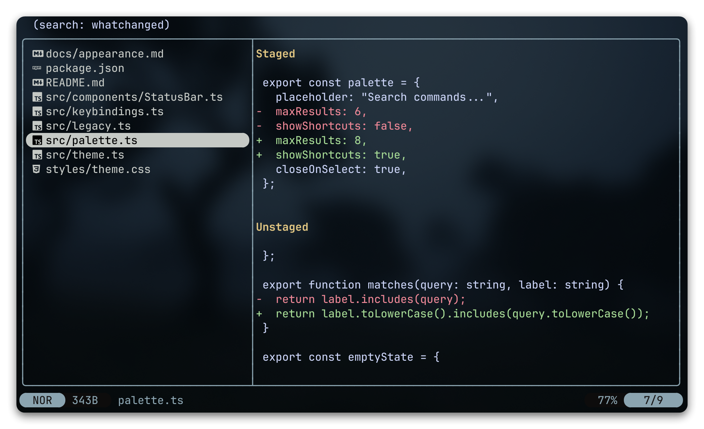

<h1 align="center">📝 whatchanged.yazi</h1>
<p align="center">
  <b>Browse Git changes and preview diffs in <a href="https://github.com/sxyazi/yazi">Yazi</a></b><br>
</p>

<p align="center">
  
</p>

---

> [!TIP]
> **Русская версия:** [README-RU.md](README-RU.md)

## Installation

> [!IMPORTANT]
> Requires [yazi](https://yazi-rs.github.io) v26.8.15+\
> Requires [git](https://git-scm.com) in `PATH`

```sh
ya pkg add WhoSowSee/whatchanged
```

```sh
# Manual installation

# Linux/macOS
git clone https://github.com/WhoSowSee/whatchanged.yazi.git ~/.config/yazi/plugins/whatchanged.yazi

# Windows
git clone https://github.com/WhoSowSee/whatchanged.yazi.git "$env:APPDATA\yazi\config\plugins\whatchanged.yazi"
```

## Setup

In `init.lua`:

```lua
require("whatchanged"):setup()
```

Or with optional settings:

```lua
require("whatchanged"):setup {
  notify = false, -- true - show preview-mode notifications
  wrap = "words", -- "words" - keep indentation, "trim" - trim indentation, "none" - no wrapping
  show_filename = false, -- true - show the file path above the diff
  show_status = true, -- false - hide per-file Git status labels
  show_branch = true, -- false - hide the branch / tracking / file-count header
}
```

At the start of `[plugin].prepend_previewers` in `yazi.toml`:

```toml
[plugin]
prepend_previewers = [
  { url = "search://*", run = "whatchanged" },
  { url = "search://*/", run = "whatchanged" },
]
```

In `keymap.toml`:

```toml
[[mgr.prepend_keymap]]
on = [ "<A-g>", "c" ]
run = "plugin whatchanged"
desc = "Toggle git changes"

[[mgr.prepend_keymap]]
on = [ "<A-g>", "r" ]
run = "plugin whatchanged refresh"
desc = "Refresh git changes"

[[mgr.prepend_keymap]]
on = [ "<A-g>", "v" ]
run = "plugin whatchanged preview"
desc = "Toggle diff / file content"

[[mgr.prepend_keymap]]
on = [ "<A-g>", "s" ]
run = "plugin whatchanged staged"
desc = "Show staged changes"

[[mgr.prepend_keymap]]
on = [ "<A-g>", "w" ]
run = "plugin whatchanged unstaged"
desc = "Show unstaged changes"

[[mgr.prepend_keymap]]
on = [ "<A-g>", "a" ]
run = "plugin whatchanged all"
desc = "Show all changes"
```

## Change filters and branch status

`all`, `staged`, and `unstaged` open the corresponding change list. Refresh keeps
the current filter, and a tab duplicated from a changes view inherits it. A file
with both staged and unstaged changes appears in both lists; each list previews
only its corresponding diff section. Untracked files and unresolved conflicts
appear in the unstaged list. `preview` still switches to the file's current content.

File labels distinguish `[staged]`, `[modified]`, `[staged+modified]`, `[new]`, and
`[conflict]`. The header shows the active filter and repository-wide file counts;
`modified` includes untracked files and conflicts, and a file can count as both
modified and staged.

For example, `main → origin/main ↓2 ↑1` means two commits to pull and one to push.
These numbers use local tracking refs from the last fetch; the plugin never
fetches or modifies the index. Branches without an upstream, deleted upstreams,
unborn branches, and detached HEAD are shown explicitly. Use `refresh` after
external Git operations to update the list and header. Ordinary directories and
other plugins' search results retain their usual labels, header, and previews.

## Validation

Run `python3 tests/acceptance.py` with Git, tmux, ripgrep (`rg`), Python 3.9+, and Yazi v26.8.15+
in `PATH`. This uses a private tmux server and temporary repositories/configuration;
it leaves the user's Yazi configuration and repositories untouched. Screens and
diagnostics are retained in the printed artifact directory when a check fails.
Set `YAZI_BINARY=/path/to/yazi` to test another installed Yazi version.

<p align="center">
  
</p>

<p align="center">
  <i><code>&copy; 2026 <a href="https://github.com/WhoSowSee">WhoSowSee</a></code></i>
</p>

<p align="center">
  <a href="LICENSE"></a>
</p>
